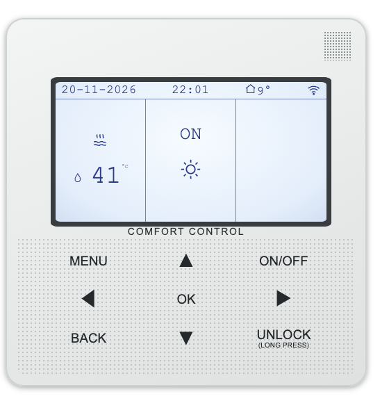
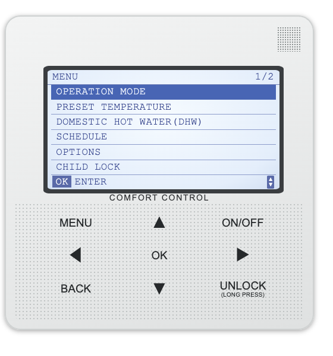
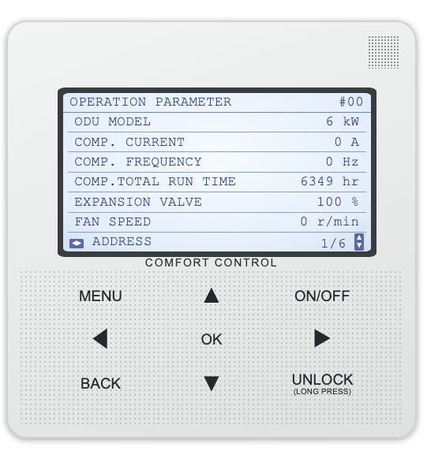
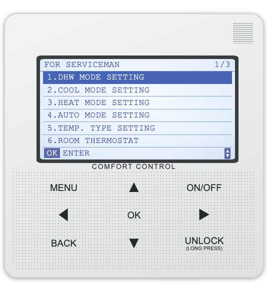

# Midea Controller Card

A Home Assistant Lovelace card that looks and works like the wired controller of a Midea M-thermal heat pump.
You step through the menus with MENU, the arrows, OK and BACK, the same way as on the wall unit.

It is built on the entities of [Mosibi/Midea-heat-pump-ESPHome](https://github.com/Mosibi/Midea-heat-pump-ESPHome).
Nothing extra is needed on the ESPHome side: the card reads and writes the existing `number`, `switch`, `select` and `sensor` entities.

| Home | Menu | Operation parameter | For serviceman |
|---|---|---|---|
|  |  |  |  |

## What it does

- **Home screen:** date, time, outdoor temperature, the zone 1 water set point (T1S), on/off, mode and compressor frequency. LEFT selects T1S and RIGHT selects the DHW tank set point (T5S), like on the wall unit: the value gets a frame and is inverted, and up/down change it. BACK or 15 seconds without a key clears the selection. ON/OFF switches zone 1 after a confirmation.
- **MENU:** OPERATION MODE, PRESET TEMPERATURE, DOMESTIC HOT WATER (DHW), SCHEDULE, OPTIONS, CHILD LOCK, SERVICE INFORMATION, OPERATION PARAMETER, FOR SERVICEMAN and WLAN SETTING.
- **Editing:** OK opens a value, up/down changes it, and OK writes it to the heat pump. BACK cancels.
- **FOR SERVICEMAN (items 1 to 17):** asks for the controller password (234) and opens only for Home Assistant admin users.
- **UNLOCK:** a long press locks and unlocks the card.
- **Not available over Modbus:** schedule, child lock, service call, test run, auto restart, HMI address and WLAN show a short note.

**Warning:** values changed here are written to the heat pump straight away. Change service parameters only if you know what they do.

## Installation

### HACS

The card is not in the HACS default list yet, so add this repository as a custom repository first.

[](https://my.home-assistant.io/redirect/hacs_repository/?owner=Yocee84&repository=midea-controller-card&category=plugin)

Or by hand:

1. In Home Assistant open **HACS**.
2. Open the three-dot menu in the top right corner and choose **Custom repositories**.
3. Repository: `https://github.com/Yocee84/midea-controller-card`, type: **Dashboard**, then **Add**.
4. Search for **Midea Controller Card** in HACS, open it and click **Download**.
5. Reload the browser (in the phone app: close and reopen it).

HACS registers the dashboard resource (`/hacsfiles/midea-controller-card/midea-controller-card.js`) for you. After that the card shows up in the card picker as **Midea wired controller**.

### Manual

1. Copy `midea-controller-card.js` to `/config/www/`.
2. Add it as a dashboard resource: `/local/midea-controller-card.js`, type **JavaScript module**.
3. Reload the browser.

## Configuration

```yaml
type: custom:midea-controller-card
entity_prefix: heatpump   # optional: the prefix of your entity ids (detected if left out)
lang: en                  # optional: en or hu, used for on-screen messages
```

The card works with the entity ids of the Mosibi configuration, for example `number.heatpump_set_water_temperature_t1s_zone_1`.
It also accepts names that carry the register number, for example `number.heatpump_002_set_water_temperature_t1s_zone_1`.
For every entity it tries the numbered form first and falls back to the plain one.

If your entities use another prefix (for example `sensor.warmtepomp_water_flow` while the device is called "Heatpump Controller"), set `entity_prefix: warmtepomp`. Every entity the card reads or writes goes through this prefix. The older `device:` option still works as an alias.

Without `entity_prefix` the card looks for the zone 1 heating switch (`switch.<prefix>_water_flow_temperature_control_zone_1`) and uses its prefix. If it finds nothing, the display shows a SETUP screen with the prefix it tried instead of OFF and empty values. Both options can also be set in the visual card editor.

## Notes

- A few FOR SERVICEMAN items (5. TEMP. TYPE SETTING and 15. INPUT DEFINE) are matched to the Modbus registers by best guess. Check them on the real controller before you change anything there.
- The labels on the OPERATION PARAMETER pages follow the controller where possible. Some values come in different units than on the display (for example the expansion valve opening in %).

## License

Apache-2.0
